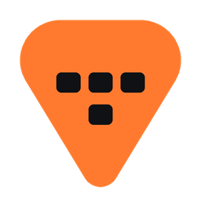
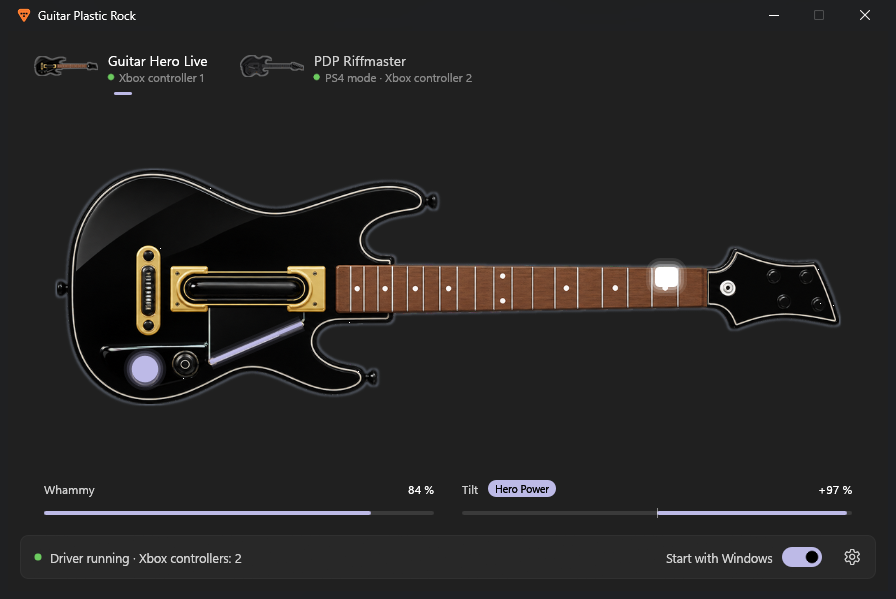
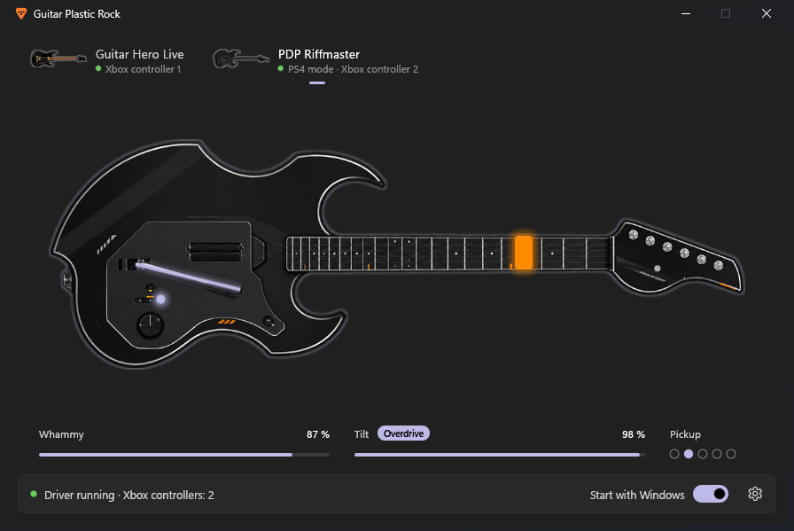
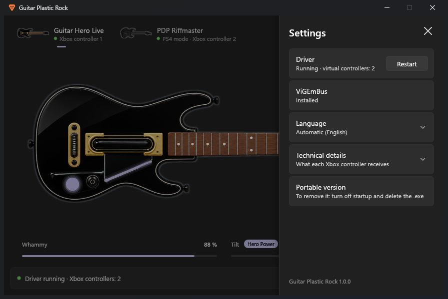

<div align="center">



<h1>Guitar Plastic Rock</h1>

<p><strong>Use your Guitar Hero Live and PDP Riffmaster guitars on PC, as Xbox controllers.</strong></p>

[](../../releases)
[](https://steamcommunity.com/id/reptilemk/)
[](https://ko-fi.com/vitalies)
[](LICENSE)

[Download](#download) · [Controller layout](#controller-layout) · [Build it yourself](#build-it-yourself) · [Support](#support-the-project)



</div>

## About

A free, unofficial Windows app for the **Guitar Hero Live** guitar (PS4 dongle) and the **PDP Riffmaster** (PlayStation version). Each guitar shows up as a virtual Xbox 360 controller, so it works in Clone Hero, YARG, RPCS3 and any game or emulator that supports Xbox controllers.

It is a single `.exe` with no dependencies: no Python, no .NET, nothing to install first. It works on a fresh Windows install. Open it, and your guitar already works as a controller.

| | Guitar Hero Live (PS4 dongle) | PDP Riffmaster (PlayStation) |
|---|---|---|
| Problem on PC | The dongle only reports **one button at a time**: you can't strum while holding frets | Frets and strum work, but **whammy and tilt never reach** the games |
| Fix | Sends the dongle's keep-alive packet every 4 s | Reads that data and hands it to an Xbox controller |
| Virtual Xbox controller | Official Xbox 360 Guitar Hero Live guitar layout | Xbox 360 Rock Band guitar layout |

## Features

- **Background driver:** one virtual Xbox 360 controller per connected guitar (both at once is fine), with an icon in the system tray. It starts when you open the app and, if you want, with Windows.
- **Visual tester:** every fret, the strum bar, whammy, tilt and buttons light up on a photo of your guitar, plus a chord check and what the Xbox controller receives.
- **Windows 11 look:** follows your light/dark mode and accent color.
- **9 languages:** English, Español, Русский, Français, Deutsch, Italiano, Português (Brasil), Polski and Українська. Your Windows language is picked automatically and can be changed in Settings.
- **Ready-made RPCS3 profiles** for Guitar Hero Live and Guitar Hero III.

<div align="center">


</div>

## Download

Get it from [Releases](../../releases). Both files contain the same program:

| | **Installer** (recommended) | **Portable** |
|---|---|---|
| File | `GuitarPlasticRock-Setup-<version>.exe` | `GuitarPlasticRock-<version>-portable.exe` |
| Install | Wizard, just for your user, no admin rights | None: run it from anywhere |
| Start with Windows | Option in the wizard and in the app | Option in the app |
| Uninstall | *Installed apps* or the button in the app | Turn off "Start with Windows" and delete the `.exe` |

1. Install it or open the portable version.
2. Plug in the receiver and turn the guitar on: the app finds it and switches to it.
3. Done: the driver is running (tray icon). You can close the window.

For the Riffmaster, **PS4 mode** is best: it is the only one that sends the pickup selector.

**ViGEmBus** ([nefarius/ViGEmBus](https://github.com/nefarius/ViGEmBus)) is the signed driver that creates the virtual controllers. It is **included** in both downloads. If you don't have it, the installer sets it up, and the portable version offers an **Install** button. It is the only step that asks for admin rights, and only once.

Requirements: Windows 10/11, 64-bit.

## Controller layout

<details>
<summary>Guitar → Xbox 360 controller</summary>

| Guitar Hero Live | Xbox 360 | | Riffmaster | Xbox 360 |
|---|---|---|---|---|
| Black 1 / 2 / 3 | A / B / Y | | Green / Red | A / B |
| White 1 / 2 / 3 | X / LB / RB | | Yellow / Blue / Orange | Y / X / LB |
| Strum | D-pad ↑↓ and left stick Y | | Solo frets | Same + LS |
| Whammy | Right stick Y (max 32000) | | Strum | D-pad ↑↓ |
| Tilt | Right stick X | | Whammy | Right stick X (0 → 32767) |
| Pause · Hero Power · GHTV | Start · Back · LS | | Tilt | Right stick Y and RT |
| D-pad / center | D-pad / Guide | | Pickup | LT |
| | | | Joystick · click · P1 | Left stick · RS · RB |

</details>

<details>
<summary>RPCS3 profiles</summary>

RPCS3 loads each game's controller profile from `config/input_configs/<game ID>/Default.yml` (**that exact name**; anything else is silently ignored). [`docs/rpcs3`](docs/rpcs3) has profiles ready to copy:

- **Guitar Hero Live** (`BLES02180`): also set *Configuration → I/O → GHLtar emulated controller: 1 controller*. The profile removes dead zones so whammy and tilt arrive undistorted. The driver caps whammy at 32000 because RPCS3 computes `~value + 1`, and a fully pressed whammy would wrap around to "released".
- **Guitar Hero III** (`BLUS30074`), with the Riffmaster: presents the controller as a PS3 RedOctane guitar (*Guitar* class, `12BA:0100`). Star Power with Select or by raising the guitar (~60 %, RT).

Both use `XInput Pad #1`: if you have several controllers, turn the guitar on first.

</details>

## Build it yourself

Don't want to trust a prebuilt download? You can build the exact same files from this source.

<details>
<summary>Requirements and build steps</summary>

### Requirements
- Windows 10/11
- [Rust](https://rustup.rs/) (MSVC toolchain) with the Visual Studio C++ build tools
- [Inno Setup 6](https://jrsoftware.org/isinfo.php), only for the installer

### Build
```bat
cargo build --release
iscc /DAppVersion=1.0.0 installer\GuitarPlasticRock.iss
```
1. `cargo build --release` builds `target\release\GuitarPlasticRock.exe`, the portable version (the C runtime is linked statically).
2. `iscc` builds `target\installer\GuitarPlasticRock-Setup-<version>.exe`.

`cargo test --workspace` checks both guitars' decoding against real captured reports, the guitar photo zones and every translation. GitHub Actions does all of this on each change and publishes a release for `v*` tags.

Command-line options: `--background` (driver), `--stop` (stops the driver and closes the windows; used by the installer), `--install-vigem`, `--demo [riff] [novigem] [settings] [langmenu]` (interface with simulated input).

</details>

## Repository layout

| Path | What |
|---|---|
| `crates\` | The app, split by layer. See [docs/ARCHITECTURE.md](docs/ARCHITECTURE.md) |
| `crates\gpr-core\` | Pure domain: guitars and their HID protocols, Xbox controller, driver status |
| `crates\gpr-i18n\` | Interface texts in 9 languages |
| `crates\gpr-platform\` | Windows: paths, log, single instance, settings, autostart, ViGEmBus, XInput |
| `crates\gpr-backend\` | Service: HID input, virtual controllers, background driver, tray icon |
| `crates\gpr-frontend\` | The app window: Windows 11 theme, widgets, views and each guitar's visuals |
| `crates\gpr-app\` | The executable: command line and Windows resources |
| `assets\` | Icon (`brand`), guitar photos for the app (`guitars`) and the original photos (`source`) |
| `installer\` | Inno Setup script |
| `docs\` | Architecture, [adding a guitar](docs/ADDING_A_GUITAR.md), RPCS3 profiles and screenshots |
| `tools\` | Python scripts that regenerate the images (development only) |
| `third_party\` | Official ViGEmBus 1.22.0 installer and its licence |

## Support the project

This app is free and made in my spare time. If it saved you time or you simply enjoy it, you can help me keep making tools like this.

[](https://ko-fi.com/vitalies)

## Credits

- **Guitar Plastic Rock:** REPTIX ([Steam](https://steamcommunity.com/id/reptilemk/))
- Device formats: [PlasticBand](https://github.com/TheNathannator/PlasticBand) documentation and the Linux `hid-sony.c` driver (GHL dongle keep-alive).
- [ViGEmBus](https://github.com/nefarius/ViGEmBus) (BSD-3-Clause), [egui](https://github.com/emilk/egui), [hidapi](https://github.com/ruabmbua/hidapi-rs), [vigem-client](https://github.com/CasualX/vigem-client), [tray-icon](https://github.com/tauri-apps/tray-icon), [windows-rs](https://github.com/microsoft/windows-rs) and the rest listed in [THIRD_PARTY_NOTICES.md](THIRD_PARTY_NOTICES.md).
- This is an unofficial fan project, not affiliated with or endorsed by Activision, FreeStyleGames, PDP or Sony. "Guitar Hero" and "Riffmaster" are trademarks of their respective owners.
- Steam and the Steam logo are trademarks and/or registered trademarks of Valve Corporation.

## Licence

The code and tools are under the [MIT licence](LICENSE). Third-party components keep their own licences (see [THIRD_PARTY_NOTICES.md](THIRD_PARTY_NOTICES.md)).

<div align="center">

[GitHub](https://github.com/vitaliesdev) · [Steam](https://steamcommunity.com/id/reptilemk/) · [Ko-fi](https://ko-fi.com/vitalies)

Made by REPTIX · Vitalie

</div>
